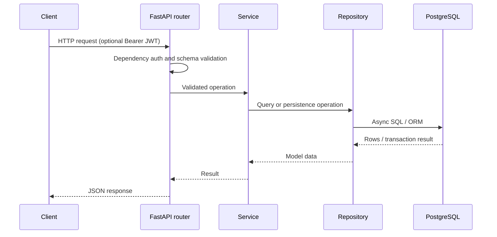

# Architecture

## Runtime entry point

`main.py` creates the FastAPI application. It mounts all domain routers under `/api/v1`, exposes an unversioned `/health` endpoint, configures CORS, security headers and SlowAPI rate limiting, and enables Swagger UI, ReDoc, and OpenAPI according to `ENABLE_API_DOCS`.

## Domain modules and request flow

Business domains live in `app/modules/`: `auth`, `users`, `directions`, `groups`, `profiles`, `teachers`, `disciplines`, `schedule`, and `locations` (with `buildings` and `rooms`). Most modules use a layered flow:

```text
HTTP request -> router -> service -> repository -> SQLAlchemy model -> PostgreSQL
                                      -> Pydantic response schema
```

Routers define HTTP paths, dependencies, response models, and status codes. Pydantic schemas validate request bodies and serialize responses. Services implement domain operations and coordinate validation. Repositories encapsulate database queries. The schedule bulk copy/delete endpoints use `ScheduleOperationsRepository` directly for set-based SQL and ORM operations.

## Database access and migrations

`app/core/database.py` creates an async SQLAlchemy engine and `async_sessionmaker`. FastAPI dependencies provide an `AsyncSession` per request; the session dependency commits after successful request handling and rolls back on exceptions. Repositories may also commit explicitly for CRUD operations. Declarative models inherit from `Base` and are imported through `app/core/models_registry.py` so Alembic can discover metadata.

Alembic is configured in `alembic.ini`; `alembic/env.py` loads application settings and model metadata and runs migrations through an async engine. Migration revisions are in `alembic/versions/`.

## Authentication, validation, and errors

`app/core/deps.py` reads Bearer tokens, verifies the JWT, resolves the active user, and enforces the `ADMIN` role where required. Pydantic validates payload types and enum values. Route handlers translate some service `ValueError`s into HTTP responses; FastAPI also returns standard request validation errors. Rate limit violations return HTTP 429. Database exceptions are rolled back by the session dependency and otherwise follow normal FastAPI exception handling.

## Frontend integration

The React/TypeScript frontend lives in the sibling `frontend/` directory. It calls the versioned JSON API through a typed Axios client, supplies a Bearer JWT, and uses TanStack Query for cached server state. The Vite development server proxies `/api` to the backend on port 8007; production must provide a same-origin proxy or configure `VITE_API_URL` with the API base URL. See [Frontend](frontend.md) for routes and client-side flows.

The `/schedule/calendar` frontend route has no client-side auth guard, but schedule and lookup API routes currently require authentication. Anonymous calendar access therefore cannot load data with the current backend access rules. Schedule notifications use the notification module and SMTP mailer; rate limiting can use Redis when `REDIS_URL` is set and otherwise uses the limiter's default in-process storage.

## Component interaction


