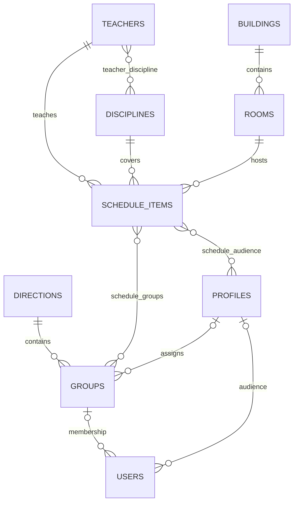

# Database

The schema below is derived from SQLAlchemy models in `app/modules/**/models.py`. PostgreSQL is the configured database. `id` columns are integer primary keys unless specified otherwise; timestamps are SQLAlchemy `DateTime` values with server-side `now()` defaults. Nullable fields are marked optional. Alembic revisions are the source for deployed schema history; the model definitions describe the current ORM schema.

## Entity relationships

## Tables

| Table                | Purpose and columns                                                                                                                                                                                                                                                                                                                                       |
|----------------------|-----------------------------------------------------------------------------------------------------------------------------------------------------------------------------------------------------------------------------------------------------------------------------------------------------------------------------------------------------------|
| `users`              | Accounts: `id`, unique/indexed `email` and `username`, `password_hash`, enum `role` (`ADMIN`, `USER`), `is_active`, nullable `group_id` and `profile_id`, `created_at`, `updated_at`. Group/profile deletion sets the corresponding FK to null.                                                                                                           |
| `directions`         | Academic programs: `id`, unique `name`, `academic_year`, nullable `description`, `is_active`, `created_at`, `updated_at`.                                                                                                                                                                                                                                 |
| `groups`             | Student groups: `id`, required indexed `direction_id`, indexed `name`, nullable `description`, `is_active`, timestamps, nullable indexed `profile_id`. Direction FK uses `RESTRICT`; profile FK uses `SET NULL`.                                                                                                                                          |
| `profiles`           | Audience/profile directory: `id`, unique indexed `name`, nullable `description`, `is_active`, timestamps.                                                                                                                                                                                                                                                 |
| `teachers`           | Staff directory: `id`, indexed `fullname`, nullable `description`, `is_active`, timestamps.                                                                                                                                                                                                                                                               |
| `disciplines`        | Subject directory: `id`, unique indexed `name`, nullable `description`, `is_active`, timestamps.                                                                                                                                                                                                                                                          |
| `teacher_discipline` | Teacher/discipline many-to-many link. Composite primary key (`teacher_id`, `discipline_id`); both FKs cascade on deletion.                                                                                                                                                                                                                                |
| `buildings`          | Buildings: `id`, unique indexed `name`, required `address`, nullable `description`, `is_active`, timestamps.                                                                                                                                                                                                                                              |
| `rooms`              | Rooms: `id`, required indexed `building_id`, `number`, nullable `description`, `is_active`, timestamps. Unique constraint `uq_room_building_number` on (`building_id`, `number`); building FK cascades.                                                                                                                                                   |
| `schedule_items`     | Lessons: `id`, required indexed `teacher_id`, `discipline_id`, `room_id`, indexed `start_datetime`, required `end_datetime`, enum `lesson_type` (`LECTURE`, `PRACTICE`, `LAB`, `SEMINAR`, `EXAM`, `CONSULTATION`), enum `status` (`PLANNED`, `CANCELLED`, `RESCHEDULED`), nullable `description`, timestamps. Teacher/discipline/room FKs use `RESTRICT`. |
| `schedule_groups`    | Schedule item/group many-to-many link. Composite primary key (`schedule_item_id`, `group_id`); both FKs cascade.                                                                                                                                                                                                                                          |
| `schedule_audience`  | Schedule item/profile many-to-many link. Composite primary key (`schedule_item_id`, `profile_id`); both FKs cascade.                                                                                                                                                                                                                                      |

The ORM model declares defaults of `true` for active flags, `USER` for account role, `LECTURE` for lesson type, and `PLANNED` for lesson status. These Python-side defaults are not equivalent to a server default unless a migration explicitly adds one. Refer to the Alembic revision for deployed defaults and exact DDL.
